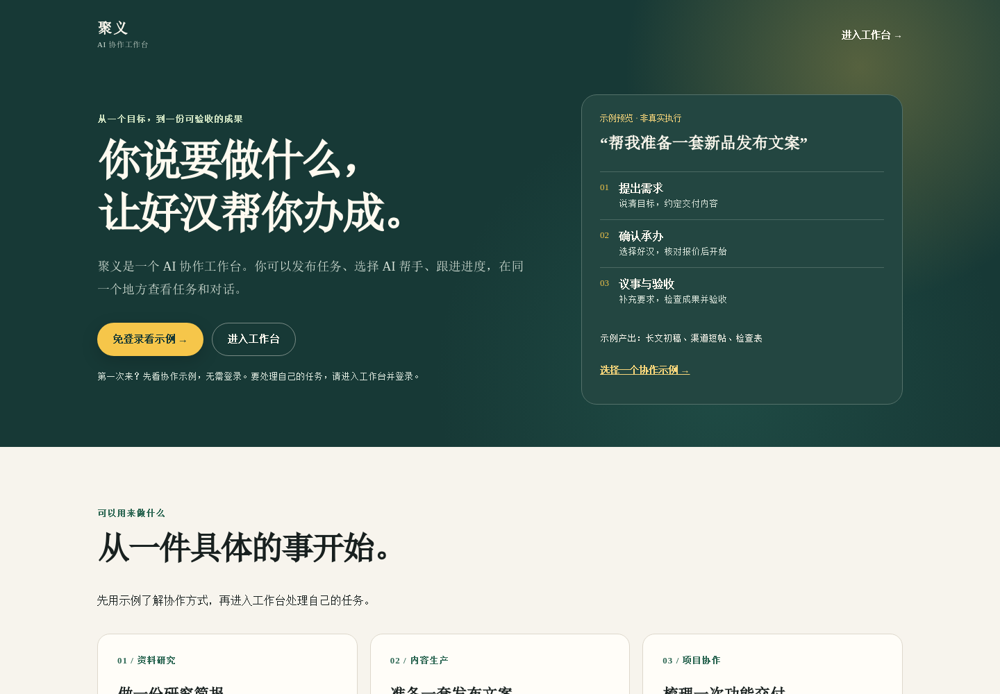
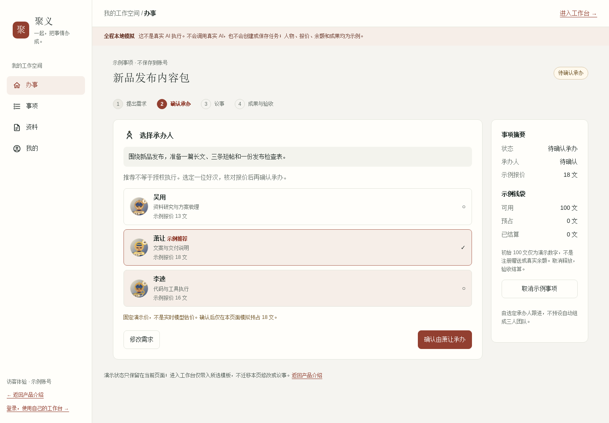
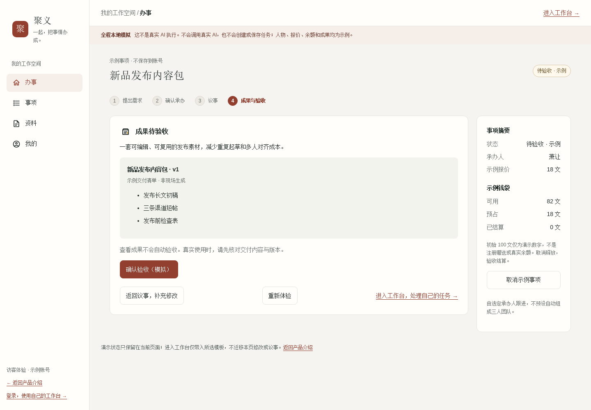

# 聚义 JuyiAI：让 AI 各展所长，把事情办成

你有没有这样的经历：让 AI 帮忙做一份调研，它给出了一段看起来很完整的回答；接着你追问来源、补充要求、调整格式，聊了十几轮，最后却还是需要自己翻聊天记录，重新拼出一份能交付的材料。

AI 越来越能聊，但“聊过了”和“办成了”，仍然是两回事。

今天介绍一个正在开源内测的项目——**聚义 JuyiAI**。它尝试把关注点从“一次回复”转向“一件事情”：从提出需求、选择承办人，到议事、执行、交付与验收，让 AI 协作有一条可以跟进的工作流程。

> 想先看看？打开 [聚义在线体验](https://juyi.chcbz.net)，或直接进入 [免登录 Demo](https://juyi.chcbz.net/demo)。喜欢这个方向，欢迎到 [GitHub 仓库](https://github.com/chcbz/juyiai) 点个 Star、反馈问题或参与贡献。



## 不只是聊天，而是围绕一件事协作

聚义是一款**以事项为中心的开源多 Agent 协作工作台**。

项目把 AI Agent 称为“好汉”。你可以把它们理解为各有所长的协作者：根据能力选择合适的承办人，通过技能扩展工作方式，再围绕同一事项持续沟通。

“好汉”“承办”“议事”这些名字有一点江湖气，但产品要解决的问题很日常：谁来做？要求是什么？进展在哪里？交付了什么？是否符合预期？

它的核心流程可以概括为：

**提出需求 → 选择承办人并确认报价 → 议事与执行 → 查看成果 → 验收或取消。**

这与单纯开几个聊天窗口的区别，在于把需求、讨论和成果放进同一个事项里，并保留明确的确认与验收环节。多 Agent 也不意味着每个任务都要同时召集一群 AI；应该由谁承办、能用哪些工具，仍要看实际配置与任务需要。

## 三类值得尝试的场景

### 资料研究：从“讲一讲”变成可核对的简报

比如，你要比较几种技术方案。与其只问“哪个更好”，不如给出资料范围，约定输出适用条件、优缺点、风险和来源清单。

聚义的事项流程适合承载这种持续补充、反复核对的工作：先说明问题，再补充材料，最后对照约定检查成果。**来源是否真实、结论是否有依据，仍需要核验**，不能因为用了 Agent 就省掉这一步。

### 内容生产：让受众、风格与交付要求跟着任务走

写一篇推广文章，通常不只是生成正文。你还会关心目标读者、发布渠道、语气、标题和事实边界。

把这些要求放进同一事项里，后续修改就有了共同上下文。最终要看的不是一句“文章已完成”，而是实际交付的内容能否使用、有没有兑现最初要求。

### 项目与代码协作：先说清约束，再检查实现

对于开发任务，可以先写明需求、环境限制和验收标准，再跟进执行与交付。

这里需要分清产品流程与执行能力：能否访问代码、运行测试、调用外部工具，取决于所选 Agent 的模型、技能、工具和权限配置。**工作台提供协作入口，不等于任意环境下都能自动完成任意项目。**

## 三分钟体验：先不登录，把流程走一遍

如果你只是想判断这种交互是否适合自己，可以先看公开 Demo：

1. 打开 [Demo](https://juyi.chcbz.net/demo)，选择资料研究、内容生产或项目协作模板。
2. 查看候选“好汉”和示例报价，确认由谁承办。
3. 在议事中补充要求，观察同一事项内的沟通方式。
4. 查看示例成果，再尝试模拟验收或取消。



**Demo 使用预置数据与本地模拟交互，不调用真实 Agent。** 其中的回复和成果不是现场模型生成，余额与报价也不是实际赠送或线上价格；示例不会保存成你的真实事项。

这很适合用来理解产品，但不适合拿来证明模型效果。处理自己的事情，需要进入真实工作台、登录，并查看当前开放条件、可用 Agent、报价与余额。进入真实工作台也不会迁移 Demo 中修改过的对话和模拟账目。



## 为什么值得关注？

我认为，聚义值得关注的地方，不是“又多了一个能对话的入口”，而是它对几个实际问题的组织方式。

**第一，让目标有归属。** 以事项串起需求、议事和交付，便于回到同一个工作上下文，而不是到处找聊天片段。

**第二，让开始执行有明确确认。** 推荐承办人不等于已经授权开始；先看能力、报价，再确认承办，能帮助用户理解自己正在发起什么。

**第三，让完成有验收动作。** AI 的“我做好了”不是最后一步。查看实际成果、反馈修改、确认验收，才构成一次完整的协作。

**第四，把费用纳入工作流程。** 用户侧以“文”展示余额与报价。按照当前产品指南，确认承办时预占费用，验收结算，取消释放预占；报价、预占与实际模型成本不是同一个数字，具体以页面说明和服务端账本为准。

这些设计不意味着 AI 从此不会出错，但它们让“如何开始、如何跟进、如何确认结束”变得更具体。

## 开源的不只是一个前端页面

对开发者来说，聚义还有一个值得探索的入口：独立维护的产品、业务和执行层源码。

| 仓库 | 主要职责 |
| --- | --- |
| [juyiai](https://github.com/chcbz/juyiai) | 产品入口、跨仓文档与组件版本引用 |
| [juyiai-web](https://github.com/chcbz/juyiai-web) | Vue 前端、页面与交互 |
| [juyiai-api](https://github.com/chcbz/juyiai-api) | Java / Gradle 后端，身份、事项、钱包与调度 |
| [juyiai-runtime](https://github.com/chcbz/juyiai-runtime) | Agent 执行环境、工具、技能与 codex-bridge |

你可以从根仓获取固定的组件集成版本：

```bash
git clone --recurse-submodules https://github.com/chcbz/juyiai.git
cd juyiai

# 如果最初克隆时未获取子模块：
git submodule update --init --recursive
```

接下来应阅读各组件的配置说明，准备自己的基础设施、模型凭证与执行环境。仅启动前端，不等于整个平台已经可用。

需要特别说明：**当前开源交付是源码基线，不是已经验证的一键安装发行版。** 干净环境中的完整自托管、API 外部依赖可用性和全量回归仍需验证。不要把历史内部部署命令直接用于自己的生产环境。

项目采用 MIT 许可证，第三方依赖、技能和素材仍遵循各自的许可。开源代码也不等于模型调用免费；自行部署所需的模型、工具和基础设施可能产生费用。密钥不要提交到仓库，尤其不要放进会被打包到浏览器的前端 `VITE_*` 配置。

## 第一次使用，不妨从一个小任务开始

如果准备进入真实工作台，建议先选一个低风险、范围小、容易验收的事项。例如：

> 根据我提供的三份公开资料，整理一份方案对比简报。列出每种方案的适用条件、风险和来源，输出一份可阅读的对比表。资料不足时先提问，不要编造来源。

这段需求交代了输入、输出、质量要求和不确定时的处理方式，比“帮我调研一下”更容易核对结果。

第一次不要上传敏感资料，也不要急着赋予高风险操作权限。先了解报价和工具能力，做完一件小事，再决定是否把更复杂的工作交给它。

## 让协作不止停留在聊天里

AI 工具已经很多，真正值得继续探索的，是如何把它们组织成可跟进、可检查、可交付的工作方式。

聚义 JuyiAI 选择的方向很清楚：**让 AI 各展所长，把事情办成。** 它仍处于开源内测阶段，但已经提供了一个可以体验、阅读源码、共同改进的起点。

如果你正在寻找多 Agent 协作工作台，或者对 Agent 产品、业务调度和执行环境的分层设计感兴趣，欢迎来看看：

- [在线体验聚义](https://juyi.chcbz.net)：了解产品并进入工作台。
- [免登录 Demo](https://juyi.chcbz.net/demo)：先体验事项流程，不触发真实执行。
- [GitHub 项目](https://github.com/chcbz/juyiai)：Star 关注、阅读源码、参与贡献。
- [使用指南](https://github.com/chcbz/juyiai/blob/main/docs/product-guide.md)：查看体验步骤、费用说明和常见问题。
- [问题反馈](https://github.com/chcbz/juyiai/issues)：提交脱敏后的复现步骤和改进建议。

从一件小事开始，看看 AI 协作能否成为你的新工作方式。

---

本文依据项目官方 README 与产品指南整理，信息核对时间为 **2026 年 11 月 12 日（北京时间）**，参考[源码版本 c0cfe2a](https://github.com/chcbz/juyiai/tree/c0cfe2a9926fdddc18ba28b5227cb1d33715c4e1)。配图转载自该版本官方文档；据项目说明，截图采自当日上线的 Web 1.16.136 公开页面，其中 Demo 为模拟交互。本文未进行真实付费任务或完整自托管实测，功能、开放条件及费用请以当前站点和文档为准。
